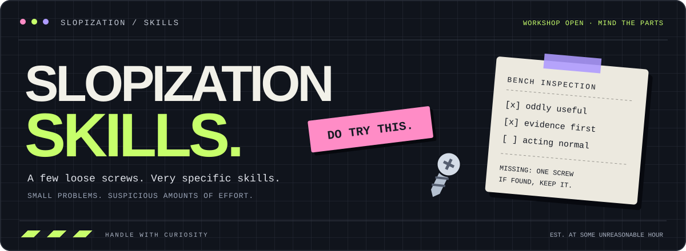

<a id="top"></a>

<div align="center">



# 쓸데없이 집요한 스킬 보관소

**“그걸 굳이 그렇게까지 해야 돼?”**<br>
네. 그래서 스킬로 만들었습니다.

<p>
  
  
  
</p>

[🧰 스킬 구경](#inventory) · [🔌 설치하고 쓰기](#quick-start) · [🧪 공방 운영 방침](#house-rules) · [📁 서랍 열기](#structure)

<sub>배지는 분위기용입니다. 분실한 나사의 위치와 개수는 검증하지 않았습니다.</sub>

</div>

---

## 🧠 여기는 뭐 하는 곳인가요

평범한 질문에 조금 과한 작업 절차를 붙입니다. 그리고 다음에도 똑같이 시킬 수 있도록 스킬로 포장합니다.

예를 들면 이런 식입니다.

> **나:** 이 동네 뭐가 맛있지?<br>
> **보통의 해결:** 지도를 켠다.<br>
> **여기의 해결:** 지자체 업무추진비를 열고, 여러 달 반복된 식당을 세고, 사무실 바로 앞이라 자주 간 건 아닌지 보정한다.<br>
> **나:** 아 배고프다.

이 저장소에는 그런 식으로 만든 **에이전트용 작업 지침**을 모읍니다. 각 스킬의 `README.md`는 사람이 읽는 설명서이고, `SKILL.md`는 에이전트가 따라갈 실행 지침입니다.

<a id="inventory"></a>

## 🧰 현재 진열된 물건

| 스킬 | 실제로 하는 일 | 꺼내 보기 |
| :--- | :--- | :--- |
| 🍚 **한국 맛집 찾기**<br>`korean-restaurant-finder` | 공식 업무추진비에서 반복 이용한 식당·카페·베이커리를 찾고, 근접 보정과 원문 출처를 붙입니다. | [사용 설명서](korean-restaurant-finder/README.md) · [실행 지침](korean-restaurant-finder/SKILL.md) |

> [!TIP]
> 지금 필요한 스킬만 골라 쓰세요. 공구함을 전부 들고 점심 먹으러 갈 필요는 없습니다.

<a id="quick-start"></a>

## 🔌 일단 꽂아 봅시다

### 01. 스킬 설치하기

Codex 대화창에서 아래처럼 요청합니다. **터미널 명령이 아니라 채팅에 붙여 넣는 요청**입니다.

```text
$skill-installer
https://github.com/slopization/skills 저장소의
korean-restaurant-finder 스킬을 설치해줘.
```

설치된 스킬은 자동으로 감지됩니다. 목록에 나타나지 않으면 Codex를 다시 시작하세요. 설치 방식은 [공식 Codex 스킬 문서](https://learn.chatgpt.com/docs/build-skills#install-curated-skills-for-local-use)를 참고할 수 있습니다.

<details>
<summary><strong>📦 로컬에 받은 파일을 직접 설치하고 싶다면</strong></summary>

저장소를 내려받은 뒤, Codex에 스킬 폴더의 실제 경로를 알려주고 설치를 요청하세요. 다른 에이전트에서는 해당 환경의 스킬 설치 방식을 따릅니다.

`SKILL.md`와 함께 스킬 폴더 전체를 가져가세요. `agents/`, `tests/`, `assets/`처럼 함께 들어 있는 파일과 문서의 상대 경로를 유지해야 합니다.

</details>

### 02. 지역을 말하기

```text
$korean-restaurant-finder
마포구 망원동에서 반복 이용 기록이 있는 식당을 찾아줘.
```

### 03. 결과와 근거를 같이 보기

맛집 후보, 반복 이용 기록, 근접 보정, 현재 영업 정보, 지도 링크와 공식 출처를 확인합니다. 자료가 부족하면 부족한 만큼만 나옵니다. 숫자를 채우려고 식당을 소환하지는 않습니다.

**실행 환경에 검색·웹 접근·다운로드·문서 읽기 도구가 필요합니다.** 이 저장소의 현재 스킬에는 전용 수집기나 집계 프로그램이 포함되어 있지 않습니다. 에이전트가 사용할 수 있는 도구와 공개 자료 상태에 따라 조사 범위가 달라집니다.

<a id="house-rules"></a>

## 🧪 공방 운영 방침

| 붙여 놓은 메모 | 실제 의미 |
| :--- | :--- |
| **이상한 발상, 구체적인 절차.** | 언제 쓰고, 무엇을 확인하고, 무엇을 내놓을지 적습니다. |
| **나사가 빠져도 출처는 안 빠지게.** | 결과를 다시 확인할 수 있도록 근거와 판단 과정을 남깁니다. |
| **모르면 모른다고.** | 못 읽은 자료와 확인하지 못한 정보를 빈칸 대신 상상력으로 채우지 않습니다. |
| **일이 커져도 범위는 지키기.** | 요청한 지역·기간·조건을 멋대로 넓히지 않습니다. |
| **다음 사람도 쓸 수 있게.** | 개별 README에 예시와 한계를, 실행 지침에 실제 규칙을 둡니다. |

<details>
<summary><strong>🙋 아무도 안 물었지만 답변은 준비했습니다</strong></summary>

**Q. 왜 이렇게까지 하나요?**<br>
A. 한 번 궁금해지면 적당한 지점에서 그만두는 기능이 가끔 작동하지 않습니다.

**Q. README만 읽으면 실행되나요?**<br>
A. README는 안내판입니다. 스킬을 지원하는 에이전트가 `SKILL.md`를 읽고 작업합니다.

**Q. 설치하면 외부 도구도 같이 생기나요?**<br>
A. 현재 스킬은 작업 지침을 제공합니다. 검색이나 문서 읽기 기능은 실행 환경에서 제공해야 합니다.

**Q. 결과가 항상 나오나요?**<br>
A. 자료와 도구가 허락하는 범위에서 나옵니다. 못 찾았다는 결과도 결과입니다. 마음은 좀 아픕니다.

**Q. 더 만들 건가요?**<br>
A. 다음으로 이상하게 구체적인 불편을 발견하면 이 진열대에 놓겠습니다.

</details>

<a id="structure"></a>

## 📁 서랍 내부

```text
skills/
├── README.md                         # 지금 보고 있는 안내판
├── assets/
│   └── readme-hero.svg                # 공방 간판
└── korean-restaurant-finder/
    ├── README.md                     # 사람이 읽는 사용 설명서
    ├── SKILL.md                      # 에이전트가 읽는 실행 지침
    ├── agents/openai.yaml            # 표시 이름과 기본 요청 예시
    ├── assets/readme-hero.svg         # 개별 스킬 간판
    └── tests/acceptance.md            # 수용 시나리오와 기존 검증 기록
```

스킬 내용을 바꿀 때는 실행 지침과 개별 README를 함께 맞추고, 동작이 달라지면 수용 시나리오도 확인합니다. 목록이 늘어나면 위 진열대에도 한 줄씩 추가합니다.

---

<div align="center">

**문제는 해결하고, 나사는 나중에 찾습니다.**

<sub>slopization / skills · oddly specific problems deserve oddly specific skills.</sub>

[↑ 맨 위로](#top)

</div>
