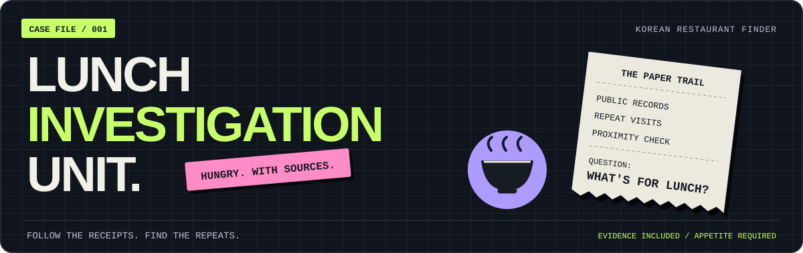

<div align="center">



# 🍚 한국 맛집 찾기

**점심 한 끼 고르려다 행정자료까지 열어 버렸습니다.**

공식 업무추진비에서 반복해서 선택된 식당·카페·베이커리를 찾는 에이전트 스킬.

<p>
  
  
  
</p>

[🚀 사용 예시](#usage) · [🔎 조사 방식](#workflow) · [🧮 점수 계산](#scoring) · [📋 실행 지침](SKILL.md) · [🧰 전체 스킬](../README.md)

</div>

---

## 🥢 배고픔이 일으킨 작은 행정조사

“이 동네에서 어디를 자주 갔을까?”를 공개된 지출 기록으로 살펴봅니다. 월별 자료를 읽고, 같은 업소를 정리하고, **서로 다른 날짜에 반복된 이용**을 찾습니다.

그런데 사무실 앞이라 자주 갔을 수도 있잖아요. 그래서 집행 주체의 근무지와 가까운 이용은 기여도를 조금 낮춥니다. 식당 하나 고르는데 여기까지 왔습니다.

> [!IMPORTANT]
> 결과는 **공개 지출에 근거한 반복 이용 후보**입니다. 맛을 보장하거나 명의자의 실제 참석·개인적 단골 여부를 증명하지 않습니다. 점수도 맛의 확률이 아닙니다.

<a id="usage"></a>

## 🚀 주문 넣는 법

설치 전이라면 [전체 README의 설치 안내](../README.md#quick-start)를 먼저 확인하세요. 설치한 뒤 에이전트 대화창에서 스킬 이름과 지역을 함께 입력합니다.

**🍚 일단 밥부터**

```text
$korean-restaurant-finder
마포구 망원동 맛집 찾아줘.
```

**☕ 밥 먹었으면 커피**

```text
$korean-restaurant-finder
성동구 성수동 카페 찾아줘.
```

**🥐 빵에도 조사 기간이 있습니다**

```text
$korean-restaurant-finder
부평구 베이커리를 2026년 1월부터 6월까지의 자료로 찾아줘.
```

지역과 업종, 필요하면 기간까지 알려주면 됩니다. 이미 정한 조건은 다시 묻지 않습니다.

## 🎛️ 조절 가능한 손잡이

| 항목 | 기본값과 동작 |
| :--- | :--- |
| **지역** | 시·군·구 또는 읍·면·동. 지역이 없거나 뜻이 불분명하면 확인합니다. 결과는 지정 지역 안의 업소로 한정합니다. |
| **업종** | 기본은 **식당**. 요청하면 **카페** 또는 **베이커리**로 전환합니다. |
| **기간** | 생략하면 한국 날짜 기준 **최근 완료된 12개월**. 게시일이 아닌 실제 집행일로 구분합니다. |
| **반복 기준** | **서로 다른 집행일 2일 이상**. 같은 날 두 번만 나온 곳은 후보가 아닙니다. |
| **결과 수** | 점수순 **최대 10곳**. 확인한 후보가 2곳이면 2곳만 나옵니다. |

예를 들어 **2026년 10월 22일**에 기간 없이 실행하면 **2025년 10월 1일~2026년 9월 30일**의 집행 내역을 봅니다.

<details>
<summary><strong>🛑 이 손잡이는 장식입니다 — 지원하지 않는 조건</strong></summary>

- “서울 전체”처럼 광역 지역만 주면 먼저 하위 시·군·구를 확인합니다.
- “역에서 반경 500m” 같은 반경 검색은 지원하지 않습니다. 원하는 동네를 확인합니다.
- 인원수·특정 메뉴·최소 등장 개월 수 선택 필터는 제공하지 않습니다.
- 자료가 적다고 지역·기간을 넓히거나 반복 기준을 낮추지 않습니다.

사무실과의 **500m 근접 보정**은 점수 계산 규칙입니다. 사용자가 지정하는 반경 검색과는 별개입니다.

</details>

<a id="workflow"></a>

## 🔎 식당 하나 찾는데 거치는 과정

```text
지역·업종·기간 정하기
         ↓
공식 업무추진비 게시판과 월별 자료 찾기
         ↓
실제 방문 소비 확인 → 중복·분할 결제 정리 → 지점·주소 확인
         ↓
서로 다른 날짜에 반복된 업소 추리기
         ↓
반복 이용 점수 계산 + 가까운 곳 보정
         ↓
현재 영업 정보 확인 → 후보·지도·출처·계산 근거 저장
         ↓
드디어 메뉴 고민을 시작할 수 있음
```

시·군·구의 **단체장·부단체장·실·국·본부장** 공개 자료를 두루 찾습니다. 동네를 지정하면 **해당 읍·면·동장** 자료도 자동으로 추가합니다. 시·군·구 전체를 검색한다고 모든 동장 자료까지 자동으로 넓히지는 않습니다.

동명이거나 이름이 비슷한 업소는 주소·지점으로 확인합니다. 중복 게시와 같은 이용의 분할 결제는 정리하고, 단순히 같은 날이라는 이유로 다른 식사를 합치지는 않습니다. 선물·사무실용 다과·식재료 구입, 명시된 배달·출장뷔페 등은 방문 소비에서 제외합니다.

<a id="scoring"></a>

## 🧮 맛집 찾다가 수학까지 하게 된 경위

**각 이용의 기여도 합 + 여러 달 등장 보너스 + 여러 집행 주체 등장 보너스**로 순서를 정합니다.

| 해당 이용에서 확인된 조건 | 이용 1건의 기여도 |
| :--- | ---: |
| 확인된 감점 조건 없음 | **1.00** |
| 해당 집행 주체의 사무실에서 직선거리 500m 이내 | **0.85** |
| 사용자가 제공한 해당 주체의 읍·면·동 수준 거주지역과 업소 지역 일치 | **0.95** |
| 위 두 조건 모두 해당 | **0.80** |

사무실은 **그 이용의 집행 주체가 근무하는 곳**으로 확인합니다. 동장 기록에 구청 주소를 일괄 적용하지 않습니다. 거주지역은 사용자가 제공한 경우만 사용하며, 상세 주거 주소를 수집하거나 기록에서 집 위치를 추정하지 않습니다.

위치·거리·주체를 확인하지 못한 이용은 **보정 미확인**으로 남기고 확인된 감점만 적용합니다. 1.00이라고 해서 “사무실에서 먼 곳”이라는 뜻은 아닙니다. 거주지역 미제공 때문에 검색을 멈추지도 않습니다.

<details>
<summary><strong>계산기를 빼앗을 수 없어서 접어 두었습니다 — 정확한 수식</strong></summary>

```text
N = 중복·분할 결제를 정리한 이용 건수
M = 집행일 기준 서로 다른 연월 수
U = 확인된 서로 다른 집행 주체 수
B = 각 이용 기여도의 합

월 보너스   = min(3, 0.5 × max(M - 1, 0))
주체 보너스 = min(3, 0.5 × max(U - 1, 0))
최종 점수   = B + 월 보너스 + 주체 보너스
```

기여도 `1.00`, `0.85`, `0.95`, `0.80`인 4건이 3개월·2주체에 걸쳤다면:

```text
B = 3.60
월 보너스 = 1.00
주체 보너스 = 0.50
최종 점수 = 5.10
```

동점은 동점으로 표시합니다. 지출액·직급·지도 별점·멀리 떨어진 정도로 추가 점수를 만들지 않습니다. 신원을 확인하지 못한 주체로 `U`를 늘리지도 않습니다.

전체 판정 규칙은 [SKILL.md](SKILL.md#반복-기준과-가까운-곳-보정)를 따릅니다.

</details>

## 📦 조사 끝나면 받는 것

| 결과 | 담기는 내용 |
| :--- | :--- |
| **조사 범위** | 지역·동네 해석·업종·기간, 대상 직책, 실제 확보한 자료와 누락 범위 |
| **후보 최대 10곳** | 상호·지점·주소·음식 종류 또는 업종, 선정 이유 |
| **반복 이용 근거** | 이용 건수 `N`, 등장 월 수 `M`, 주체 수 `U`, 보정 내역과 최종 점수 |
| **방문 전 확인 정보** | 현재 영업 상태와 확인일, 지도 링크, 이전·폐업·미확인 여부 |
| **다시 볼 수 있는 출처** | 공식 게시글·첨부 URL, 파일명, 페이지·시트·행과 필요한 발췌 |

결과와 출처, 추출 기록, 제외·보류 이유, 점수 계산 근거는 지정한 위치 또는 작업 공간의 새 결과 폴더에 저장합니다. **저장한 파일을 다시 읽어 확인한 뒤**, 이번 실행에서 다운로드한 임시 원본만 정리합니다. 사용자 원본과 기존 결과는 정리 대상이 아닙니다.

> [!NOTE]
> 자료가 없거나 읽히지 않으면 그 사실을 표시합니다. 후보를 확인하지 못하면 그렇게 답하고, 일반 맛집 검색 결과로 빈자리를 채우지 않습니다. 10칸을 채우는 능력보다 2곳의 근거를 설명하는 쪽을 택했습니다.

## 🔧 준비물과 현실적인 한계

검색·브라우저·다운로드·문서 읽기·계산 등 **실행 환경이 제공하는 도구**로 작업합니다. 전용 수집기·집계 스크립트, 고정 게시판 주소나 특정 지도 서비스에 의존하지 않습니다.

XLS/XLSX·PDF·HWP/HWPX 등의 공개 자료는 환경에서 가능한 읽기·미리보기·변환·문자 인식으로 처리합니다. 도구가 없거나 파일을 읽지 못하면 확보 범위를 밝힙니다. 모든 사이트와 문서 형식을 항상 읽을 수 있다는 뜻은 아닙니다.

지도 검색 링크만 확보한 경우에는 **검색 링크**라고 표시합니다. 검색 결과 한 줄만 보고 영업 중이라고 확정하지 않습니다. 점심에 진심이어도 폐업을 취소할 수는 없습니다.

<details>
<summary><strong>🧪 스킬을 고치거나 검증하는 사람용 서랍</strong></summary>

| 파일 | 역할 |
| :--- | :--- |
| [SKILL.md](SKILL.md) | 입력 해석·수집·판별·점수·출력·정리의 실행 규칙 |
| [agents/openai.yaml](agents/openai.yaml) | 표시 이름, 짧은 설명, 기본 요청 예시 |
| [tests/acceptance.md](tests/acceptance.md) | 가상 자료 수용 시나리오와 기존 제작 검증 기록 |

수용 시나리오는 **스킬 제작·수정·평가용**입니다. 실제 맛집 조사 전에 매번 테스트부터 요구하지 않습니다. 기존 검증 기록의 범위와 한계는 해당 문서에 적혀 있습니다.

</details>

---

<div align="center">

**입맛은 주관적이어도, 출처 링크는 눌러 볼 수 있어야 하니까.**

<sub>korean-restaurant-finder · a very specific answer to a very ordinary hunger.</sub>

[🧰 다른 스킬 보러 가기](../README.md) · [📋 실행 지침 읽기](SKILL.md)

</div>
